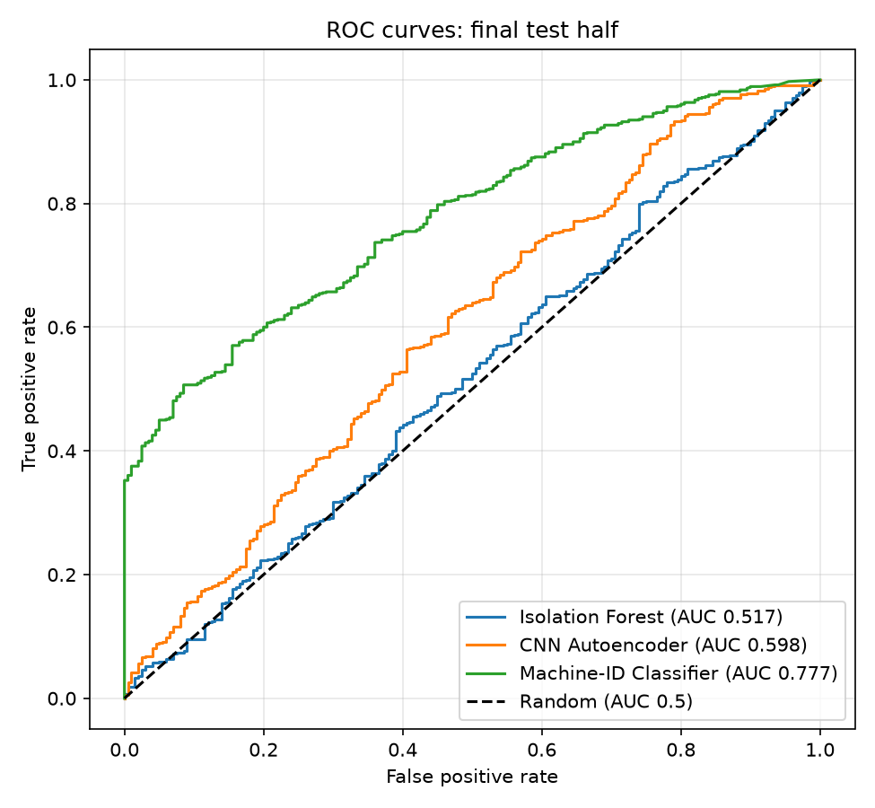
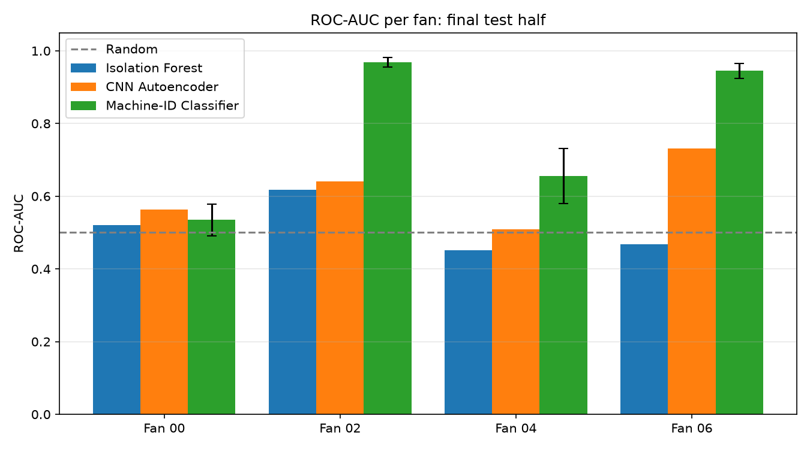

# Acoustic Anomaly Detection for Industrial Machine Condition Monitoring

Detecting faulty industrial fans from their sound, using deep learning models trained **only on normal recordings**.

This project compares three unsupervised anomaly detection approaches on the DCASE 2020 Task 2 fan dataset. It also includes a Streamlit dashboard for analysing individual recordings.

## Key idea

In real factories, recordings of healthy machines are plentiful but recordings of faults are rare. So every model here learns only what *normal* sounds like, and flags recordings that differ from it.

Our best approach trains a CNN to recognise **which fan** is producing a sound. When a fan develops a fault, its acoustic "fingerprint" changes, and the model becomes less confident that it is hearing the expected fan. That drop in confidence is used as the anomaly score.

## Results

Evaluated once on a held-out half of the test set (938 clips: 200 normal, 738 anomalous) that was never used for model selection.

| Model | ROC-AUC | Fan 00 | Fan 02 | Fan 04 | Fan 06 | Precision | Recall | False alarm rate |
|---|---|---|---|---|---|---|---|---|
| Isolation Forest (baseline) | 0.517 | 0.521 | 0.618 | 0.451 | 0.468 | 0.811 | 0.058 | 0.050 |
| CNN Autoencoder | 0.598 | 0.563 | 0.640 | 0.509 | 0.731 | 0.873 | 0.084 | 0.045 |
| **CNN Machine-ID Classifier** (mean of 3 seeds) | **0.781 ± 0.010** | 0.535 | **0.968** | 0.656 | **0.945** | **0.970** | **0.467** | 0.053 |




**Findings**
- At a similar false-alarm rate (about 5%), the Machine-ID Classifier detects about **47%** of faulty recordings, compared with 8% for the autoencoder.
- Performance is stable across random seeds (ROC-AUC std 0.010).
- Fans 02 and 06 are detected very reliably. Fan 04 is moderate, and Fan 00 is near chance for all methods.

## Method

**Data:** the fan subset of the [DCASE 2020 Task 2 development dataset](https://zenodo.org/records/3678171), derived from MIMII. It contains 10-second, 16 kHz recordings from four fans (IDs 00, 02, 04, 06).

**Preprocessing:** each recording is converted to a log-Mel spectrogram (128 Mel bands, n_fft 1024, hop 512), then standardised per Mel band using statistics from the training split only.

**Data splits**

| Split | Clips | Purpose |
|---|---|---|
| Train | 3,307 (normal) | Model training |
| Validation | 368 (normal) | Early stopping and threshold selection |
| Test, dev half | 937 | Comparing approaches |
| Test, final half | 938 | Final reported results (used once) |

**Models**
1. **Isolation Forest:** summary features (mean and std of each Mel band).
2. **CNN Autoencoder:** reconstructs 2-second spectrogram patches. The anomaly score is the mean reconstruction error.
3. **CNN Machine-ID Classifier:** a small CNN (about 98k parameters) predicts the fan ID. The anomaly score is −log p(correct fan ID), averaged over patches.

**Threshold:** the 95th percentile of validation scores, which targets roughly 5% false alarms on normal machines. ROC-AUC is the main metric, because the test set is imbalanced (79% anomalous).

**Overfitting control:** a validation set, early stopping, weight decay, dropout, and a narrow bottleneck (for the autoencoder).

## Dashboard

An interactive Streamlit app. Pick a test clip or upload a WAV file to see:
- the spectrogram
- the anomaly score and the Normal/Anomaly verdict
- the model's confidence for each fan
- the final results

```
streamlit run app/dashboard.py
```

## Project structure

```
acoustic-anomaly-detection/
├── app/
│   └── dashboard.py              Streamlit dashboard
├── data/                         (not in repo: download separately)
│   ├── raw/fan/                  Original WAV files (train/, test/)
│   └── processed/                Cached spectrograms, metadata, normalisation stats
├── results/
│   ├── figures/                  Plots used in the report
│   ├── metrics/                  CSV files with scores and results
│   └── models/                   (not in repo) Trained model files
├── src/
│   ├── config.py                 Paths and settings
│   ├── check_setup.py            Checks that all libraries are installed
│   ├── audio_utils.py            Audio loading, log-Mel spectrograms
│   ├── explore_audio.py          Plots a normal vs anomalous example
│   ├── prepare_data.py           Train/val split, spectrogram cache, normalisation stats
│   ├── split_test.py             Test set split into dev and final halves
│   ├── data_utils.py             Loads the processed data
│   ├── features.py               Summary features for the baseline
│   ├── metrics_utils.py          Shared evaluation metrics
│   ├── baseline_iforest.py       Isolation Forest baseline
│   ├── model.py                  CNN autoencoder and patch utilities
│   ├── train_autoencoder.py
│   ├── evaluate_autoencoder.py
│   ├── id_classifier.py          Machine-ID classifier and scoring
│   ├── train_id_classifier.py
│   ├── evaluate_id_classifier.py
│   └── final_evaluation.py       Final results and figures
├── .gitignore
├── README.md
└── requirements.txt
```

## How to run (Windows, CPU only)

**1. Setup**
```
python -m venv .venv
.venv\Scripts\activate
pip install -r requirements.txt
```

**2. Data:** download `dev_data_fan.zip` from [Zenodo](https://zenodo.org/records/3678171) and extract it into `data/raw/`, so that you have `data/raw/fan/train/` and `data/raw/fan/test/`.

**3. Run the pipeline, in order**
```
python src/prepare_data.py
python src/split_test.py
python src/baseline_iforest.py
python src/train_autoencoder.py
python src/evaluate_autoencoder.py
python src/train_id_classifier.py
python src/train_id_classifier.py --seed 1
python src/train_id_classifier.py --seed 2
python src/evaluate_id_classifier.py
python src/final_evaluation.py
streamlit run app/dashboard.py
```

On a laptop CPU, each neural network takes roughly 15–45 minutes to train.

## Limitations

- **One machine type only** (fans), and anomalies are detected per known machine ID.
- **Fan 00 remains near chance** for all methods, and Fan 04 results vary across seeds.
- **The system flags unusual sounds; it does not diagnose the specific fault.**
- **Training showed occasional validation loss spikes.** A learning-rate schedule could improve stability.

## Future work

- Evaluate on other machine types (e.g. valves, pumps) without re-tuning.
- Try per-machine models, other features, or newer DCASE datasets with domain shift.
- Improve training stability and Fan 00 performance.

## Dataset and references

- Y. Koizumi et al., "Description and Discussion on DCASE2020 Challenge Task2: Unsupervised Anomalous Sound Detection for Machine Condition Monitoring," DCASE Workshop, 2020.
- H. Purohit et al., "MIMII Dataset: Sound Dataset for Malfunctioning Industrial Machine Investigation and Inspection," DCASE Workshop, 2019.

The dataset is licensed under CC BY-NC-SA 4.0 and is not included in this repository.

## Author

Anannya Singh,Khushi  7th-semester minor project